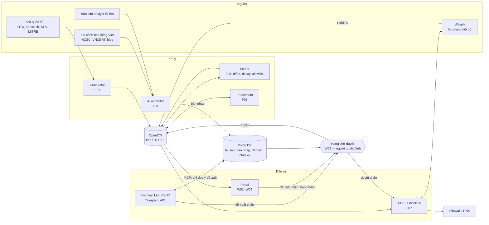
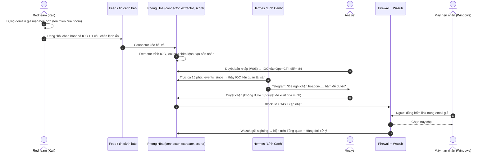

# Luồng hệ thống Phong Hỏa (bản hoàn chỉnh, 22/10/2026)

Ba luồng chạy song song, gặp nhau ở **OpenCTI** (kho tri thức) và **Hàng chờ duyệt** (W05) — nơi con người quyết định trước khi máy hành động.

## 1. Sơ đồ tổng thể

## 2. Luồng A — Thu thập tự động (mỗi 30 phút)
1. Connector kéo feed → `phonghoa_core.normalize` → tạo STIX với ID cố định (khử trùng lặp).
2. Enrichment bổ sung WHOIS, ASN, VirusTotal khi cần.
3. Scorer tính điểm mỗi giờ: tin cậy nguồn × xác nhận × độ mới × liên quan tài sản; allowlist → 0.
4. Indicator điểm ≥ 60 vào TAXII + blocklist; firewall và Wazuh tự kéo về.

## 3. Luồng B — Báo cáo văn bản → tri thức (AI extractor)
1. Báo cáo vào (connector tin tiếng Việt, analyst tải lên, hoặc gửi link cho bot).
2. Quét chèn lệnh → regex → LLM (chỉ TLP CLEAR/GREEN) → đối chiếu bằng chứng → chuẩn hóa ATT&CK → lọc allowlist.
3. Bản nháp vào W05; Analyst tích/bỏ tích → duyệt → Report + object STIX trên OpenCTI.
4. Số mục bị sửa được ghi lại → Precision/Recall thực tế cho chương 4.

## 4. Luồng C — Trực ca chủ động (Hermes, ý tưởng Grok Bot)
1. Mỗi 15 phút: `events_since` → có IOC mới liên quan tài sản / cảnh báo Wazuh / CVE KEV mới?
2. Tự điều tra: tra IOC → làm giàu → thực thể liên quan → tóm tắt.
3. Thao tác thay đổi → chỉ tạo đề xuất ở W05 + nhắn Telegram.
4. 07:00 hằng ngày: bản tin; thứ Hai: tóm tắt tuần cho lãnh đạo.

## 5. Kịch bản demo đầu-cuối (dùng khi bảo vệ)

## 6. Ranh giới an toàn (áp dụng cho cả 3 luồng)
| Ranh giới | Cách bảo đảm |
|---|---|
| Không thay đổi nào không có người duyệt | Mọi chặn/xuất/đổi trạng thái đi qua W05; người đề xuất không tự duyệt |
| AI không làm theo chỉ thị trong dữ liệu | Bọc văn bản ngoài; extractor không có công cụ; Hermes chỉ có công cụ đọc + đề xuất |
| Dữ liệu nhạy cảm không ra ngoài | TLP AMBER/RED không gửi LLM cloud |
| Không chặn nhầm hạ tầng hợp pháp hay tài sản của mình | Allowlist + tài sản tự vào allowlist |
| Biết khi dữ liệu không đủ | Panel tình trạng nguồn; nguồn lỗi hiện đỏ |

Chi tiết từng khối: `docs/specs/` (F01–F08, X01, A01, W00–W05).
